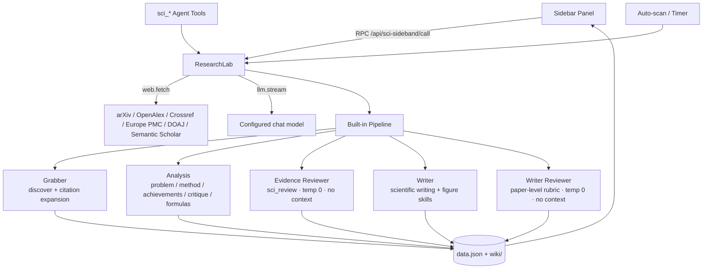

# Architecture

- No subagent sessions are required; the scheduler is a plugin method.
- `sci_pipeline` and the panel button call the same `pipeline.start` action.
- `sci_review` is a separate stateless reviewer call; writer and writer-reviewer are distinct stages.
